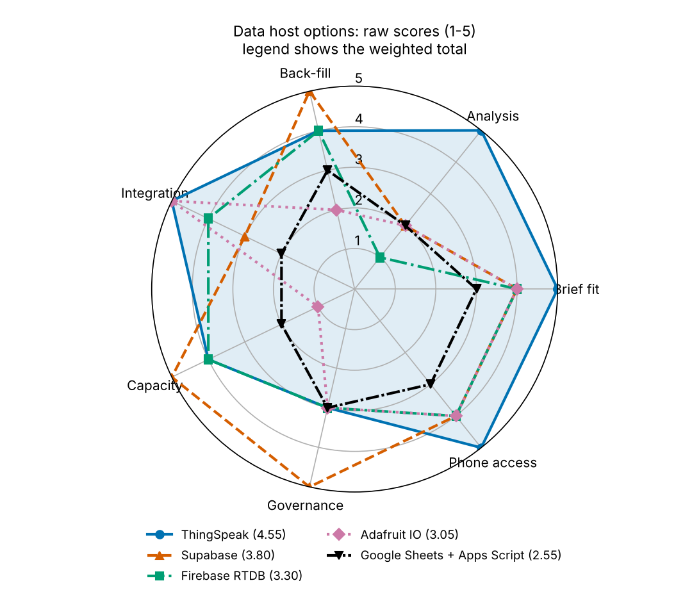

# Decision matrix: data host (AM, 13 Nov 2026)

Method: Week 2b weighted decision matrix. Scores 1 (poor) to 5 (excellent); weights sum to 1. Weights come from the client brief (free, secure, timed transmission), Lem's design (MATLAB on ThingSpeak) and requirements F7-F9.

| Criterion | Weight | ThingSpeak | Supabase | Firebase RTDB | Adafruit IO | Google Sheets + Apps Script |
|---|---|---|---|---|---|---|
| Client brief fit: free, HTTPS, authenticated writes | 0.20 | 5 | 4 | 4 | 4 | 3 |
| Built-in analysis and charts (MATLAB, report figures) | 0.20 | 5 | 2 | 1 | 2 | 2 |
| Offline back-fill with device timestamps (F7) | 0.15 | 4 | 5 | 4 | 2 | 3 |
| ESP32 integration effort and team familiarity | 0.15 | 5 | 3 | 4 | 5 | 2 |
| Free-tier capacity and retention for our load | 0.10 | 4 | 5 | 4 | 1 | 2 |
| Data governance: region, export, deletion (DMP) | 0.10 | 3 | 5 | 3 | 3 | 3 |
| Phone dashboard access: CORS, public read, embeds | 0.10 | 5 | 4 | 4 | 4 | 3 |
| **Weighted total** | 1.00 | **4.55** | **3.80** | **3.30** | **3.05** | **2.55** |

Ranking: 1. ThingSpeak (4.55), 2. Supabase (3.80), 3. Firebase RTDB (3.30), 4. Adafruit IO (3.05), 5. Google Sheets + Apps Script (2.55)

## Sensitivity

- Weights: every criterion weight scaled by 0.5, 1 or 1.5 independently and renormalised (2187 combinations): ThingSpeak first in 2184, Supabase first in 3. Smallest ThingSpeak lead: -0.09 points; median lead +0.75.
- Scores: every score moved by -1, 0 or +1 at random (20,000 draws): ThingSpeak first in 95.8 %, Supabase first in 3.9 %, Firebase RTDB first in 0.3 %.

## Reasons for each score

- **ThingSpeak**: Free licence, HTTPS, per-channel write key; MATLAB Analysis + Visualizations built in (Lem's design); bulk_update.json takes created_at, 960 entries/request, 15 s spacing; MathWorks ESP32 examples; 3 M msgs/yr vs our ~0.53 M (18 %); US-hosted, CSV export and clear-channel available; public channels with CORS * and iframe charts.
- **Supabase**: Free tier but projects pause after a week of inactivity; Postgres only, analysis and charts are our own code; any timestamp insertable in batches; REST from ESP32 needs auth headers and row-level-security setup; 500 MB; London region (best governance); anon-key REST reads, no ready-made charts.
- **Firebase RTDB**: Free Spark plan, HTTPS; no analysis or charting; timestamps are our own keys; community ESP32 library; 1 GB storage; region selectable but Google account and rules to manage; REST reads.
- **Adafruit IO**: Free tier, HTTPS, easiest Arduino library; simple dashboards only; free plan limited to 30 data points/min and 30 days of storage (fails the >7-day and report-archive needs).
- **Google Sheets + Apps Script**: Free; Apps Script web-app redirects are awkward from an ESP32 over HTTPS; Sheets charts only; quota limits; university uses Microsoft 365, so accounts and governance sit outside the DMP.

## Consequence for the design

ThingSpeak is chosen; Supabase (the 27 Oct DMP draft) is replaced. The DMP is updated (docs/DMP_v2.md). Main ThingSpeak weakness: US hosting and no automatic backup -> mitigated by weekly CSV export to the group OneDrive and the device's 8-day buffer.

**University enterprise offering (design-brief feedback, comment 18).** The marker asked whether the proof of concept could run on the University's enterprise offering instead of Supabase. It does: ThingSpeak and MATLAB come with the University of Surrey's MathWorks Campus-Wide licence (Total Academic Headcount), used here through a @surrey.ac.uk account, and the backups go to the University's Microsoft 365 OneDrive. No service outside the University's own licences holds measured data.
